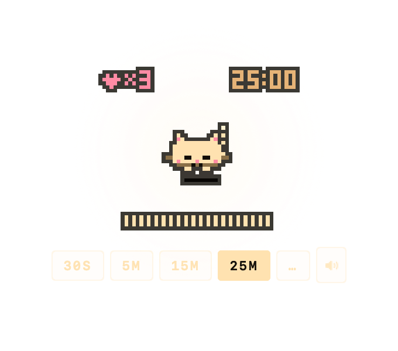

# Timi

Timi is a pixel cat for macOS that also runs a focus timer. She sits on top of
your windows. Her body language shows the state of the timer, so the clock stays
hidden most of the time. She draws everything into a canvas of 56×48 pixels.

Timi started as a web prototype, `Prototype/mochi-timer.jsx`. ("Mochi" was her
working name.) The app copies the behavior and the pixels of the prototype
exactly, with a small number of documented changes for macOS. The
[design notes](docs/design.md) list each change.

| Idle | Hunt | Finish | Nap | Loaf |
|---|---|---|---|---|
|  |  |  |  |  |



## What Timi does

During a session:

- Timi breathes faster as the session continues.
- At the halfway point and when one quarter of the time remains, she hops and
  trills.
- In the last 10 seconds, she hunts. She crouches, her eyes stay wide open and
  do not blink, and her tail whips.
- In the last 3.5 seconds, she wiggles. At 0:00 she pounces into confetti.
- After the pounce, she has the zoomies: a short burst of fast running. Then
  she rests in a loaf position, with her paws under her body.
- The tick sound fades after the first 20 seconds and is silent after 45
  seconds. It returns for the last minute.
- After about 13 seconds without input, she curls into a ball and naps.
- She wakes for each milestone and for the last minute, with a mew and a big
  stretch.

Her body:

- Her tail has four segments that move with physics. It sways when she is calm,
  and it hangs when you carry her.
- During the hunt, her tail puffs and whips. When she sleeps, it curls around
  her.
- Her ears perk when the pointer comes near. They lie flat during the hunt,
  when she moves faster than 420 pt/s in a drag or a flight, and when she is
  sad.

Between sessions:

- You can drag Timi and fling her. She bounces off the screen edges. If you
  throw her too hard, she hisses.
- Hold her for a moment to pat her. She does a slow cat blink, purrs, and
  blushes, and a small pat heart rises.
- For a few seconds after the timer resets at the end of a session, she kneads
  with her paws.

Cost:

- Timi uses about 1.5–2% CPU when idle and about 1% when she naps. The
  [Energy](#energy) section has the measurements.
- She has no Dock icon. She does not take focus from your current app. Only
  Settings and the **Custom…** dialog take focus, and they give it back when
  they close.
- The App Sandbox gives Timi no network access.

## Install

Run this command in Terminal:

```sh
brew install 2ls-llc/tap/timi
```

The tap repository is
[`2ls-llc/homebrew-tap`](https://github.com/2ls-llc/homebrew-tap).

### Open Timi the first time

Apple did not notarize the current releases, so macOS blocks Timi the first
time you open her. To open Timi:

1. Open Timi from your Applications folder.
2. When macOS shows an alert, click **Done**.
3. Open **System Settings > Privacy & Security**.
4. Find the message about Timi.
5. Click **Open Anyway**.
6. If macOS asks for your password, enter it.

You must do these steps again after each update, until we sign and notarize
the releases.

If you prefer Terminal, this command removes the quarantine flag and has the
same result:

```sh
xattr -dr com.apple.quarantine /Applications/Timi.app
```

### Build from source

```sh
git clone https://github.com/2ls-llc/timi && cd timi
./Packaging/build.sh
```

The script writes `dist/Timi.app`. The app is universal (Apple silicon and
Intel), sandboxed, and has an ad-hoc signature. The
[Development](#development) section gives the Xcode requirement.

## Use

- **Tap** Timi to start the timer. Tap again to pause, and tap again to resume.
- After 0:00, a tap resets the timer. If you do not tap, the timer resets by
  itself after 6.4 seconds.
- **Hold** Timi for half a second or more, without moving the pointer, to pat
  her. A pat never changes the timer.
- **Drag** Timi to move her. She stays where you drop her. If you **fling** her,
  she bounces.
- **Scroll** over Timi while the timer is idle to change the session length by
  1 minute per step. The range is 1–90 minutes.
- **Hover** over Timi to show the controls strip.
  - When the timer is idle, the strip has chips for the presets `30S`, `5M`,
    `15M`, and `25M`. It also has a mute chip, and a `…` chip for a custom
    length from 0.5 to 90 minutes.
  - After you set a custom length, the `…` chip shows that length, for example
    `12M`.
  - While the timer runs, the strip has pause, mute, and reset chips.
  - During a pause, the strip stays visible.
- Press **⌃⌥T** in any app to start, pause, or resume the timer. You can change
  this hotkey in Settings.

Each completed session earns a heart. The heart flies from Timi into the **♥×n**
tally at the top left of her canvas. The tally counts the hearts of today.

If you reset a session after more than 15 seconds, Timi frowns for 5 seconds
and makes a short "mrrp" sound.

### Menu bar

The menu bar icon is a small picture of Timi. It is monochrome when the timer
is idle or done. It is in color while a session runs and during a pause. At
those times, the remaining time also shows next to the icon. You can hide this
time in Settings.

The menu has these items:

- The first item changes with the timer state: **Start**, **Pause**,
  **Resume**, or **Reset**. A separate **Reset** item follows it.
- The presets, and **Custom…**
- **Sound**, **Show Timi** or **Hide Timi**, and **Cabinet Frame (CRT Look)**
- **Launch at Login**, and **Show Tips**
- Your hearts: today, all time, and your streak (when it is 2 days or more)
- **Settings…**, and **Quit Timi**

**Cabinet Frame (CRT Look)** puts Timi in the small amber CRT stage of the
prototype, with scanlines. This option is also in Settings.

### Mouse modes

**Settings > Respond to the mouse** has three modes:

- **When hovering Timi** (the default): Timi accepts clicks on the cat and on
  the controls strip. A click on the transparent area around her goes to the
  window below.
- **Only while holding ⌥**: while you hold the Option key, Timi and the
  transparent area around her accept clicks. At other times, each click goes to
  the window below.
- **Always**: Timi and the transparent area around her always accept clicks.

## Energy

These values come from `top -pid` on an Apple silicon Mac, with a release
build. Each value covers sample runs of several seconds. The budget from the
original specification is in parentheses.

| State | CPU |
|---|---|
| Idle on the desktop (30 fps) | 1.4–2.2%, average about 1.8% (< 2%) |
| Napping during a session (12 fps, ticks silent) | 0.9–1.5% (< 2%) |
| Running with audible ticks (30 fps and synth) | 2.9–3.3% (< 4%) |
| Finish (60 fps, confetti, fanfare) | peak 9.3% (< 12%) |

The frame loop runs at 60 fps only while something moves. These cases need
60 fps: a drag, a flight, a hop, the finish, the hunt, moving confetti or
hearts, and a pointer near Timi. At rest the loop runs at 30 fps, and
while Timi sleeps it runs at 12 fps. The loop stops when Timi is hidden, when
the screen locks, and when the screens sleep.

The timer uses the wall clock (`endAt`), and a `DispatchSourceTimer` makes the
ticks. The timer never depends on the frame rate, and it keeps exact time
through system sleep. If the deadline passes while the Mac sleeps, the session
finishes quietly when the Mac wakes.

## Architecture

```
Sources/TimiKit        Deterministic core, with no AppKit
  Engine/              TimerCore (wall clock), Physics, DurationFormat,
                       PalEngine (the prototype's frame loop, ported field
                       by field, with a seeded RNG)
  Render/              PixelCanvas (56×48 RGBA8), Font3x5, Sprites,
                       Palette, Renderer
  Audio/               SynthDSP: polyBLEP chip synth with the envelopes of
                       the prototype, and the cat voice (meow, mew, trill,
                       mrrp, purr, hiss)
  Characters/          Timi's constants: palette, timings, sounds
  Persistence/         Models for settings and session records
Sources/Timi           AppKit shell
  Window/              PalPanel (borderless, non-activating, click-through),
                       ControlsStrip, GlowLayer, CabinetLayer, HintLabel
  App/                 PalController (display link, frame rate, input),
                       menu bar item, Settings (SwiftUI), hotkey,
                       notifications, login item, debug console
  Audio/               ChipSynth: AVAudioSourceNode host that pauses when silent
  Persistence/         UserDefaults settings store, sessions.json ledger
```

Timi draws the canvas with nearest-neighbor scaling at exactly 3 points per
canvas pixel. On a Retina screen, each canvas pixel is 6×6 device pixels.
Sprites never rotate. Squash and stretch use an axis-aligned layer transform.

The [design notes](docs/design.md) explain the porting decisions. The
[behavior reference](docs/behavior.md) lists each behavior, its constants, and
the checks that cover it.

## Development

```sh
swift build            # debug build
swift test             # 116 tests: timer, physics, engine, DSP, canvas,
                       # session stats, formatting, persistence, and
                       # golden snapshots (Tests/snapshots/golden-*)
swift run Timi         # run without an app bundle (no notifications or login item)
```

To build Timi, you need the full Xcode app. The Command Line Tools alone cannot
build Timi. A dependency uses SwiftUI `#Preview` macros, and their compiler
plugin is part of Xcode. KeyboardShortcuts 2.4.0 also needs Swift 6.1 or
later. Swift 6.1 first shipped with Xcode 16.3, so older versions of Xcode
cannot build Timi. The CI workflows use Xcode 26.2.

If the build fails with the error *external macro implementation type
'PreviewsMacros.SwiftUIView' could not be found*, do these steps:

1. If Xcode is not on your Mac, install it.
2. Run `sudo xcode-select -s /Applications/Xcode.app/Contents/Developer`.
3. Build again.

Set `TIMI_DEBUG_DIR` to enable a debug console that reads commands from a file:

```sh
TIMI_DEBUG_DIR=/tmp/timi swift run Timi
```

Write commands to `/tmp/timi/cmd`, one command per line. The commands control
the app and save images of the panel. `Sources/Timi/App/DebugHarness.swift`
lists the commands. The console works only without the App Sandbox, for
example with `swift run`. The sandboxed app cannot read the folder.

### Releases

The scripts in `Packaging/` make a release:

```sh
./Packaging/build.sh                    # universal .app with an ad-hoc signature
CODESIGN_IDENTITY="Developer ID Application: …" ./Packaging/build.sh
APPLE_ID=… APPLE_TEAM_ID=… APP_PASSWORD=… ./Packaging/notarize.sh
VERSION=0.1.0 ./Packaging/release.sh    # zip and sha256 for the cask
```

Each push to `main`, and each pull request, runs `.github/workflows/ci.yml`.
This workflow runs the tests and the universal build.

A tag that starts with `v` runs `.github/workflows/release.yml`. This workflow
does these steps:

1. It runs the tests.
2. It builds the universal app.
3. If the signing secrets exist, it signs and notarizes the app. If they do not
   exist, it makes an ad-hoc build, and the release notes give the first-launch
   steps.
4. It publishes a GitHub release with the zip.
5. If the `TAP_GITHUB_TOKEN` secret exists, it opens a pull request that
   updates `Casks/timi.rb` in `2ls-llc/homebrew-tap`.

## Credits

The web prototype in `Prototype/` is the original design of Timi. The app keeps
every constant of the prototype, every fidget probability, and every ease rate
of her tail physics.

Global hotkeys use
[KeyboardShortcuts](https://github.com/sindresorhus/KeyboardShortcuts) by Sindre
Sorhus, under the MIT License. **Settings > About** shows its license notice.

© Two Ls LLC
