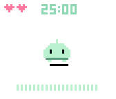
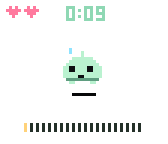
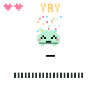
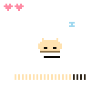
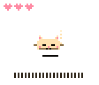
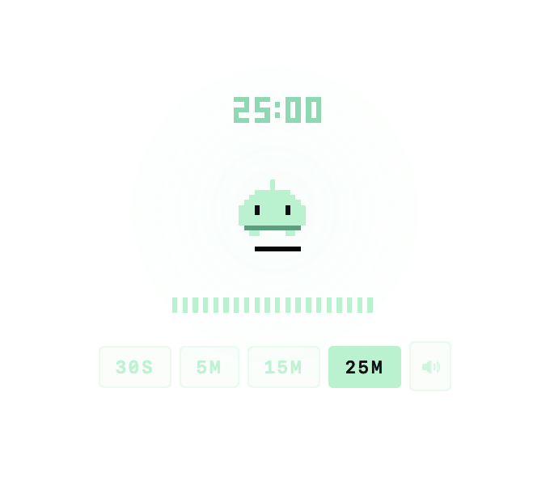

# Pixel Pal

A tiny 1-bit pixel pet that lives on top of your windows — and is also a focus
timer. Pip (a mint blob) and Mochi (an amber cat) breathe, blink, nap, panic,
pounce, and celebrate their way through your work sessions. Everything the pal
does is drawn into a 56×48 pixel canvas floating over your desktop.

Born as two web prototypes (`Prototype/pip-timer-v4-3.jsx`,
`Prototype/mochi-timer.jsx`); this is their native macOS home, ported
behavior-for-behavior and pixel-for-pixel.

| Idle | Panic | Done | Mochi naps | Mochi loafs |
|---|---|---|---|---|
|  |  |  |  |  |

On the desktop:



## What it does

- **It's a companion, not a widget.** Timer state shows through body language:
  breathing speeds up as the session progresses, milestones get a hop and a
  chirp, the final ten seconds are full panic (Pip sweats; Mochi crouches into
  a hunt and *pounces* at 0:00, gets the zoomies, then settles into a
  satisfied loaf).
- **It respects focus.** Tick sounds fade out as you settle in; after ~13
  undisturbed seconds the pal falls asleep (Mochi curls into a ball). It wakes
  for milestones and the last minute.
- **It's a toy between sessions.** Drag it around, fling it — it bounces off
  screen edges (Mochi hisses if you throw it too hard). Hold briefly to pat:
  happy squints, blush, a floating heart; Mochi slow-blinks and purrs.
- **It's nearly free.** ~1.5–2% CPU idle, ~1% napping (see *Energy* below).
  No Dock icon, never steals focus, zero network.

## Install

```sh
brew install msull92/tap/pixel-pal
```

(The tap repo is `msull92/homebrew-tap`.) Until releases are signed and
notarized, macOS quarantine will block the app; install with:

```sh
brew install --no-quarantine msull92/tap/pixel-pal
```

Or build from source:

```sh
git clone https://github.com/msull92/pixel-pal && cd pixel-pal
./Packaging/build.sh          # → dist/PixelPal.app (universal, sandboxed, ad-hoc signed)
```

## Use

- **Tap** the pal: start → pause → resume. Tap after the celebration resets.
- **Hold** (≥ half a second, without moving): pat. Never touches the timer.
- **Drag / fling** anywhere. It settles where you drop it, or bounces if flung.
- **Scroll** over the pal while idle: ±1 minute (1–90).
- **Hover** reveals the controls strip: presets `30s · 5m · 15m · 25m` + mute
  while idle; pause/resume · mute · reset while running (pinned while paused).
- **⌃⌥Space** starts/pauses from anywhere (configurable in Settings).
- The **menu bar** icon (template when idle, tinted while running) carries the
  whole menu: presets, Custom…, character switching, sound, show/hide,
  cabinet frame, launch at login, hearts + streak, Settings.
- Every completed session earns a **heart** — it flies from the pal's head to
  the row in the corner of its canvas. The row shows today; the menu shows
  lifetime and streak. Quitting a session more than 15 seconds in earns you a
  brief guilt-trip frown (Mochi adds a reproachful *mrrp*).
- **Cabinet frame** (menu or Settings) wraps the pal in the prototypes' little
  CRT stage — scanlines and all — if you miss the web version's look.

Interaction modes (Settings): interactive on hover (default), only while
holding ⌥, or always. The transparent margins of the floating panel are always
click-through in hover/⌥ modes.

## Energy

Measured with `top -pid` on an Apple Silicon Mac, release build, over multi-
second sample runs (spec budget in parentheses):

| State | CPU |
|---|---|
| Idle on the desktop (30 fps) | 1.4–2.2%, avg ≈1.8% (< 2%) |
| Napping in a session (12 fps, ticks silent) | 0.9–1.5% (< 2%) |
| Running, ticks audible (30 fps + synth) | 2.9–3.3% (< 4%) |
| Finish celebration (60 fps, confetti, fanfare) | peak 9.3% (< 12%) |

The frame loop runs at 60 fps only while something moves (drag, flight, hops,
celebration, panic, particles, cursor near), 30 fps at rest, 12 fps asleep,
and pauses entirely when hidden, the screen locks, or displays sleep. The
timer itself is wall-clock (`endAt`) with `DispatchSourceTimer` ticks — it
never depends on frame cadence and stays exact through system sleep (a
deadline that passes while the Mac sleeps finishes quietly on wake).

## Architecture (for the curious)

```
Sources/PixelPalKit     deterministic core — no AppKit
  Engine/    TimerCore (wall-clock), Physics, PalEngine (the prototype's
             frame-loop state machine, ported field-for-field, seeded RNG)
  Render/    PixelCanvas (56×48 RGBA8), Font3x5, Sprites, Renderer
  Audio/     SynthDSP — polyBLEP chip synth, WebAudio-faithful envelopes
  Characters/ Pip & Mochi constants + per-character behavior
Sources/PixelPal        the AppKit shell
  Window/    PalPanel (borderless, non-activating, click-through), layers
  App/       PalController (display link, cadence, input), status bar,
             settings (SwiftUI), hotkey, notifications
  Audio/     ChipSynth — AVAudioSourceNode host, auto-pauses when silent
```

The canvas is rendered nearest-neighbor at exactly 3 pt per logical pixel
(6 device pixels per cell on Retina); sprites never rotate, squash/stretch is
an axis-aligned layer transform. Where the two prototypes disagree in tiny
ways (Pip can blink mid-panic, Mochi can't; Mochi's wall-hit *boing* has a
softer attack), the port preserves each file's behavior — see `PLAN.md` for
every resolved ambiguity and `CHECKLIST.md` for the verification ledger.

## Development

```sh
swift build            # debug build
swift test             # 89 tests: timer, physics, engine behavior, DSP,
                       # golden canvas snapshots (Tests/snapshots/golden-*)
swift run PixelPal     # run without a bundle (notifications/login disabled)
```

`PIXELPAL_DEBUG_DIR=/tmp/pal swift run PixelPal` enables a file-based debug
console (`/tmp/pal/cmd`) used to script and screenshot the app during
development — see `Sources/PixelPal/App/DebugHarness.swift`.

Release packaging:

```sh
./Packaging/build.sh                    # universal .app, ad-hoc signed
CODESIGN_IDENTITY="Developer ID Application: …" ./Packaging/build.sh
APPLE_ID=… APPLE_TEAM_ID=… APP_PASSWORD=… ./Packaging/notarize.sh
VERSION=0.1.0 ./Packaging/release.sh    # zip + sha256 for the cask
```

Tagging `v*` runs `.github/workflows/release.yml`: tests → universal build →
sign + notarize when secrets exist (otherwise an ad-hoc build with a note in
the release) → GitHub Release → PR bumping `Casks/pixel-pal.rb` in
`msull92/homebrew-tap`.

## Credits

Pip and Mochi were designed as web prototypes (included under `Prototype/`).
The native port keeps their souls intact: every constant, every fidget
probability, every one of Mochi's tail-physics ease rates.
