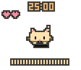
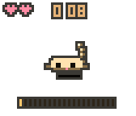
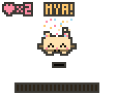
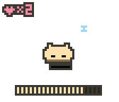
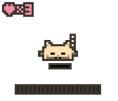

# Timi

A tiny pixel cat that lives on top of your windows — and is also a focus timer.
Timi breathes, blinks, naps, hunts, pounces, and celebrates her way through your
work sessions. Everything she does is drawn into a 56×48 pixel canvas floating
over your desktop.

Timi was born as a web prototype (`Prototype/mochi-timer.jsx`, written under her
working name); this is her native macOS home, ported behavior-for-behavior and
pixel-for-pixel.

| Idle | The hunt | Done | Napping | Loafing |
|---|---|---|---|---|
|  |  |  |  |  |

On the desktop:



## What she does

- **She's a companion, not a widget.** Timer state shows through body language:
  breathing speeds up as the session progresses, milestones get a hop and a
  trill, and the final ten seconds are a *hunt* — she crouches with locked wide
  eyes and a whipping tail, wiggles her butt in the last 3.5 seconds, and
  **pounces** into the confetti at 0:00, gets the zoomies, then settles into a
  satisfied loaf.
- **She has a real tail** — four-segment chain physics. It sways when she's
  content, hangs when you carry her, puffs and whips during the hunt, and curls
  around her when she sleeps. Her ears perk when you arrive, flatten when she's
  stressed, and droop when you abandon a session.
- **She respects your focus.** Tick sounds fade out as you settle in; after ~13
  undisturbed seconds she curls into a ball for a proper cat nap. She wakes for
  milestones and the last minute — with a mew and a big stretch.
- **She's a toy between sessions.** Drag her around, fling her — she bounces
  off screen edges (and hisses if you throw her too hard). Hold briefly to pat:
  a cat slow-blink, purring, blush, and a floating heart. While she's happy and
  idle, she kneads.
- **She's nearly free.** ~1.5–2% CPU idle, ~1% napping (see *Energy*).
  No Dock icon, never steals focus, zero network.

## Install

```sh
brew install 2ls/tap/timi
```

(The tap repo is `2ls/homebrew-tap`.) Until releases are signed and
notarized, macOS quarantine will block the app; install with:

```sh
brew install --no-quarantine 2ls/tap/timi
```

Or build from source:

```sh
git clone https://github.com/2ls/timi && cd timi
./Packaging/build.sh          # → dist/Timi.app (universal, sandboxed, ad-hoc signed)
```

## Use

- **Tap** Timi: start → pause → resume. Tap after the celebration resets.
- **Hold** (≥ half a second, without moving): pat. Never touches the timer.
- **Drag / fling** anywhere. She settles where you drop her, or bounces if flung.
- **Scroll** over her while idle: ±1 minute (1–90).
- **Hover** reveals the controls strip: presets `30s · 5m · 15m · 25m` + mute
  while idle; pause/resume · mute · reset while running (pinned while paused).
- **⌃⌥Space** starts/pauses from anywhere (configurable in Settings).
- The **menu bar** cat (template when idle, tinted while running) carries the
  whole menu: presets, Custom…, sound, show/hide, cabinet frame, launch at
  login, hearts + streak, Settings.
- Every completed session earns a **heart** — it flies from Timi's head to the
  row in the corner of her canvas. The row shows today; the menu shows lifetime
  and streak. Quitting a session more than 15 seconds in earns you a brief
  guilt-trip frown and a reproachful *mrrp*.
- **Cabinet frame** (menu or Settings) wraps her in the prototype's little amber
  CRT stage — scanlines and all — if you miss the web version's look.

Interaction modes (Settings): interactive on hover (default), only while
holding ⌥, or always. The transparent margins of the floating panel are always
click-through in hover/⌥ modes.

## Energy

Measured with `top -pid` on an Apple Silicon Mac, release build, over multi-
second sample runs (spec budget in parentheses):

| State | CPU |
|---|---|
| Idle on the desktop (30 fps) | 1.4–2.2%, avg ≈1.8% (< 2%) |
| Napping in a session (12 fps, ticks silent) | 0.9–1.5% (< 2%) |
| Running, ticks audible (30 fps + synth) | 2.9–3.3% (< 4%) |
| Finish celebration (60 fps, confetti, fanfare) | peak 9.3% (< 12%) |

The frame loop runs at 60 fps only while something moves (drag, flight, hops,
celebration, the hunt, particles, cursor near), 30 fps at rest, 12 fps asleep,
and pauses entirely when hidden, the screen locks, or displays sleep. The
timer itself is wall-clock (`endAt`) with `DispatchSourceTimer` ticks — it
never depends on frame cadence and stays exact through system sleep (a
deadline that passes while the Mac sleeps finishes quietly on wake).

## Architecture (for the curious)

```
Sources/TimiKit         deterministic core — no AppKit
  Engine/    TimerCore (wall-clock), Physics, PalEngine (the prototype's
             frame-loop state machine, ported field-for-field, seeded RNG)
  Render/    PixelCanvas (56×48 RGBA8), Font3x5, Sprites, Renderer
  Audio/     SynthDSP — polyBLEP chip synth, WebAudio-faithful envelopes,
             and the cat voice (meow, mew, trill, mrrp, purr, hiss)
  Characters/ Timi's constants (palette, timings, sounds)
  Persistence/ settings + session-record models
Sources/Timi            the AppKit shell
  Window/    PalPanel (borderless, non-activating, click-through), layers
  App/       PalController (display link, cadence, input), status bar,
             settings (SwiftUI), hotkey, notifications
  Audio/     ChipSynth — AVAudioSourceNode host, auto-pauses when silent
  Persistence/ UserDefaults settings store, sessions.json ledger
```

The canvas is rendered nearest-neighbor at exactly 3 pt per logical pixel
(6 device pixels per cell on Retina); sprites never rotate, squash/stretch is
an axis-aligned layer transform. `PLAN.md` documents every porting decision and
`CHECKLIST.md` is the verification ledger.

## Development

```sh
swift build            # debug build
swift test             # 86 tests: timer, physics, engine behavior, DSP,
                       # golden canvas snapshots (Tests/snapshots/golden-*)
swift run Timi         # run without a bundle (notifications/login disabled)
```

`TIMI_DEBUG_DIR=/tmp/timi swift run Timi` enables a file-based debug console
(`/tmp/timi/cmd`) used to script and screenshot the app during development —
see `Sources/Timi/App/DebugHarness.swift`.

**Building requires full Xcode** (15.4 or newer), not just the Command Line
Tools: a dependency uses SwiftUI `#Preview` macros, whose compiler plugin ships
inside Xcode.app. If you see *"external macro implementation type
'PreviewsMacros.SwiftUIView' could not be found"*, run
`sudo xcode-select -s /Applications/Xcode.app/Contents/Developer` (installing
Xcode first if needed) and build again.

Release packaging:

```sh
./Packaging/build.sh                    # universal .app, ad-hoc signed
CODESIGN_IDENTITY="Developer ID Application: …" ./Packaging/build.sh
APPLE_ID=… APPLE_TEAM_ID=… APP_PASSWORD=… ./Packaging/notarize.sh
VERSION=0.1.0 ./Packaging/release.sh    # zip + sha256 for the cask
```

Tagging `v*` runs `.github/workflows/release.yml`: tests → universal build →
sign + notarize when secrets exist (otherwise an ad-hoc build with a note in
the release) → GitHub Release → PR bumping `Casks/timi.rb` in
`2ls/homebrew-tap`.

## Credits

Timi was designed as a web prototype (included under `Prototype/`, where she
went by a working name). The native port keeps her soul intact: every constant,
every fidget probability, every one of her tail-physics ease rates.

© Two Ls LLC
